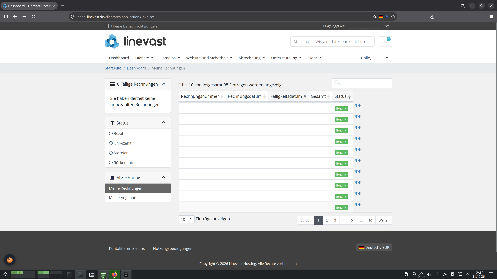

# 004 Browser Scripts / Bare Scripts / **Linevast Invoice PDF Download**
A script that adds a PDF Button to Linevast Invoices, simplifying the process of downloading all your invoices.

Script written in 10/2026. No liability.

## How to use
1. Make sure you're logged into Linevast
2. Navigate to the invoices section (https://panel.linevast.de/clientarea.php?action=invoices)
3. Open browser console (CTRL + Shift + I)
4. Paste the code from below into the browser console
5. Download the PDFs by clicking each respective PDF button
6. Repeat for each invoices page


## Code
```JS
document.querySelectorAll("#tableInvoicesList tbody tr").forEach((i) => {
	let idnr = i.querySelector("td:first-child").innerText;
	i.innerHTML += `
		<a href="https://panel.linevast.de/dl.php?type=i&id=${idnr}" target="_blank" download>PDF</a>
	`;
})
```

## Screenshot

